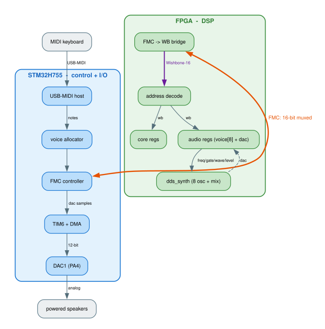

# signalmesh

signalmesh is a hybrid analog/digital synthesizer: an STM32H755 handles control and I/O,
and an FPGA does the DSP. It is an open source hardware, firmware and gateware project.

## repositories

- [signalmesh](https://github.com/akielaries/signalmesh): firmware, FPGA gateware, tools, these docs
- [signalmesh_CAD](https://github.com/akielaries/signalmesh_CAD): schematics and board CAD, published at [akielaries.github.io/signalmesh_CAD](https://akielaries.github.io/signalmesh_CAD/)

## docs

- [ACM synth architecture](acm-synth-architecture.md): STM32 + FPGA split, FMC register map, note flow
- [FPGA targets](fpga-targets.md): Tang Nano 20K, Tang Primer 25K, Basys 3, MAIN_COMPUTE_BOARD: resources, features, builds, Vivado
- [releasing](releasing.md): per-module `version.yml` driven releases
- [note flow and system diagram](https://viewer.diagrams.net/?nav=1#Uhttps%3A%2F%2Fraw.githubusercontent.com%2Fakielaries%2Fsignalmesh%2Fmain%2Fdocs%2Fnote-flow.drawio): draw.io, two pages (Gowin dev setup, MAIN_COMPUTE_BOARD)
- [developer notes](https://github.com/akielaries/signalmesh/blob/main/DEV.md): building and flashing the firmware

## diagrams

